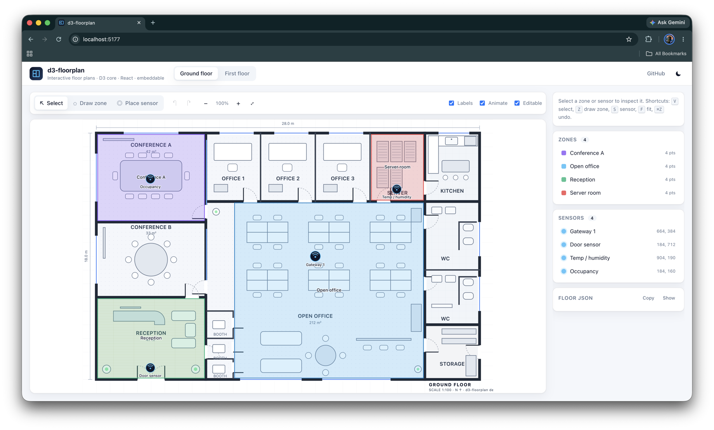

# d3-floorplan

Interactive floor plans for the web. Draw and edit zones, place and drag sensors, pan and zoom, all on top of your own floor plan image.

- **Framework-agnostic core** built on D3 v7 modules (`d3-selection`, `d3-drag`, `d3-zoom`, `d3-polygon`).
- **React component** (`d3-floorplan/react`) with a controlled API and an undo/redo hook.
- **Embeddable script** build that exposes `window.Floorplan`, no bundler required.
- **Animations** via [motion.dev](https://motion.dev).
- TypeScript types included. Apache-2.0.

**Live demo:** https://allnash.github.io/d3-floorplans/



## Using the demo

Run `npm run dev` (or open the live demo) and you get the editor shown above.

- **Floor tabs** at the top switch between floors. Edits are kept per floor.
- **Select** mode (default, `V`): click a zone or sensor to select it. Drag a zone to move it, hover a zone and drag its corner handles to reshape it, drag a sensor to reposition it. Scroll to zoom, drag the background to pan.
- **Draw zone** (`Z`): click to place vertices. Click the first vertex, double-click, or press `Enter` to close the shape. `Esc` cancels. The new zone is selected and the editor returns to Select mode.
- **Place sensor** (`S`): click anywhere on the plan to drop a sensor.
- **Right-click** a zone or sensor to rename or delete it. Right-click the background to start a zone or place a sensor at that spot, or to zoom to fit.
- **Toolbar**: undo/redo (`⌘Z` / `⇧⌘Z`), zoom in/out, fit to view (`F`), and toggles for labels, animation and read-only mode.
- **Inspector** (right panel): rename the selection, change a zone's colour, or delete it. The Zones and Sensors lists select on click.
- **Floor JSON**: shows the live `Floor` object. Copy it to seed your own app; it is the exact shape `FloorPlan` and `createFloorplan` accept.
- `Delete` or `Backspace` removes the selection. `Esc` deselects.

## Install

```bash
npm install d3-floorplan
```

The React entry needs `react` and `react-dom` 18 or 19 as peer dependencies.

## React

```tsx
import { useState } from 'react';
import { FloorPlan, type Floor, type Mode } from 'd3-floorplan/react';

const initial: Floor = {
  id: 'ground',
  name: 'Ground floor',
  image: { url: '/floorplans/ground-floor.svg', x: 0, y: 0, w: 1200, h: 800 },
  zones: [{ id: 'z1', name: 'Reception', points: [[44, 524], [356, 524], [356, 756], [44, 756]] }],
  sensors: [{ id: 's1', name: 'Gateway', x: 664, y: 384, w: 32, h: 32 }],
};

export function Plan() {
  const [floor, setFloor] = useState(initial);
  const [mode, setMode] = useState<Mode>('select');
  return (
    <>
      <button onClick={() => setMode('drawZone')}>Draw zone</button>
      <button onClick={() => setMode('placeSensor')}>Place sensor</button>
      <FloorPlan floor={floor} onChange={setFloor} mode={mode} onModeChange={setMode} />
    </>
  );
}
```

The component is controlled: every edit calls `onChange` with a **new** floor object, and you pass it back in. The stylesheet is imported automatically.

`useFloorState(initialFloor)` gives you `floor`, `setFloor`, `undo`, `redo`, `canUndo`, `canRedo` and a few convenience editors, all sharing one history.

A `ref` exposes `zoomToFit()`, `zoomBy(factor)`, `cancelDrawing()`, `toFloor(clientX, clientY)` and `getInstance()`.

## Vanilla JS / any framework

```js
import { createFloorplan } from 'd3-floorplan';
import 'd3-floorplan/style.css';

const plan = createFloorplan(document.getElementById('plan'), { mode: 'select' });
plan.setFloor(floor);
plan.on('change', (e) => {
  floor = e.floor; // fresh object; e.type is e.g. 'zone:add', 'sensor:move'
});
plan.setMode('drawZone');
```

### Script tag (no build step)

```html
<link rel="stylesheet" href="https://unpkg.com/d3-floorplan/dist/d3-floorplan.css" />
<script src="https://unpkg.com/d3-floorplan/dist/d3-floorplan.iife.js"></script>
<script>
  const plan = Floorplan.createFloorplan(document.getElementById('plan'));
  plan.setFloor(floor);
</script>
```

See [`examples/vanilla`](examples/vanilla) and [`examples/react`](examples/react).

## Data model

```ts
interface Floor {
  id: string;
  name: string;
  image: { url: string; x: number; y: number; w: number; h: number };
  zones: { id: string; name: string; points: [number, number][]; color?: string; data?: object }[];
  sensors: { id: string; name: string; url?: string; x: number; y: number; w: number; h: number; data?: object }[];
}
```

All coordinates are in the floor image's own units (usually its pixel size). The SVG `viewBox` is set from `image`, so the plan is responsive and crisp at any zoom. Use an SVG floor plan if you have one.

## Interactions

| Mode          | Behaviour                                                                                                      |
| ------------- | -------------------------------------------------------------------------------------------------------------- |
| `select`      | Click to select. Drag zones, their vertices (handles show on hover) and sensors. Wheel zooms, background pans. |
| `drawZone`    | Click to place vertices. Click the first vertex, double-click or press Enter to close. Esc cancels.            |
| `placeSensor` | Click to drop a sensor.                                                                                        |

Right-click opens a context menu (rename, delete, start zone here, place sensor here, zoom to fit). Delete/Backspace removes the selection. Esc deselects or leaves the current mode.

## Options

| Option                 | Default        | Description                                                              |
| ---------------------- | -------------- | ------------------------------------------------------------------------ |
| `mode`                 | `'select'`     | Interaction mode.                                                        |
| `zoom`                 | `true`         | Wheel zoom and background pan.                                           |
| `minZoom` / `maxZoom`  | `0.5` / `8`    | Scale limits.                                                            |
| `labels`               | `true`         | Show zone and sensor names.                                              |
| `editable`             | `true`         | Allow dragging and deleting. `false` gives a read-only viewer.           |
| `animate`              | `true`         | motion.dev enter/exit/zoom animations.                                   |
| `contextMenu`          | `true`         | Built-in right-click menu.                                               |
| `onContextMenu`        |                | Customise or replace the menu items; return `null` to suppress.          |
| `rename`               | `window.prompt`| Async-capable rename callback.                                           |
| `sensorIcon`           | built-in SVG   | Default icon for sensors without a `url`.                                |
| `sensorSize`           | `32`           | Size of sensors placed through the UI.                                   |
| `generateId` / `generateName` |         | Id and name generators for new items.                                    |
| `width` / `height`     | responsive     | Fixed viewport size in CSS pixels.                                       |

Events: `change`, `select`, `modechange`, `zoom`, `drawing`.

## Styling

Everything is driven by CSS custom properties on `.fp-container`:

```css
.my-plan {
  --fp-zone-fill: #22c55e;
  --fp-zone-stroke: #15803d;
  --fp-selected: #f59e0b;
  --fp-label: #111;
}
```

Zones can also carry their own `color`. Stroke widths and handle sizes compensate for zoom automatically.

## Development

```bash
npm install
npm run dev          # demo site with hot reload (examples/react)
npm test             # vitest (pure ops + jsdom engine tests)
npm run build        # dist/: ESM core, React entry, IIFE bundle, CSS, types
npm run build:demo   # static demo site into site/
```

## Migrating from d3.v4.floorplan

The 0.x code was a prototype tied to D3 v4 globals. 1.0 is a rewrite:

- `d3.floorplan()` → `createFloorplan(container, options)`; no global `d3` required.
- `imageLayers`, `zonePolygons`, `drawZonePolygon`, `sensorImageLayer` are replaced by `setFloor(floor)` and `setMode(mode)`.
- Edits no longer mutate your objects; subscribe to `change` and keep the floor it gives you.
- Pan/zoom now works (`zoom` option, `zoomToFit`, `zoomBy`).
- The same `Floor` JSON shape is accepted; `image`, `zones[].points` and `sensors[].x/y/w/h` are unchanged.

## License

Apache-2.0 © Nash Gadre
